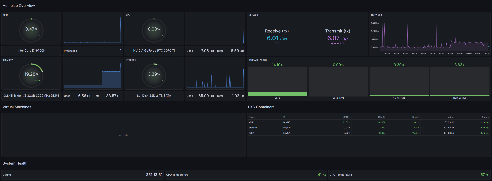
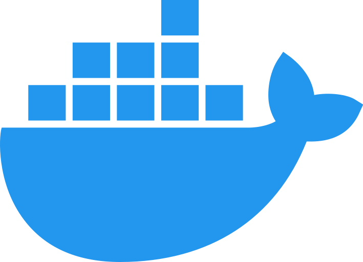

# 🛡️ Stefans Homelab

Stand: 06.11.2026

Dieses Repository dokumentiert den schrittweisen Aufbau meines privaten Homelabs. Die Konfigurationsdateien der Server liegen versioniert mit im Repo.

Das Homelab läuft im Dauerbetrieb und trägt Dienste, die ich im Alltag nutze. Gleichzeitig dient es als Grundlage für eine Laborumgebung zum Lernen, Testen und Entwickeln. Sie soll typische Enterprise-Infrastruktur wie Virtualisierung, segmentierte Netze, Monitoring, Windows- und Linux-Systeme sowie perspektivisch Security-Detection abbilden.


<sub>*Bild KI-generiert.*</sub>

> **Hinweis:** Das Homelab befindet sich in aktiver Entwicklung und die Doku zieht laufend nach. Einzelne Komponenten können schon umgesetzt, aber noch nicht vollständig dokumentiert sein. Jede Seite trägt deshalb oben ein "Stand"-Datum.


# 🖥️ Server

Die Basis ist mein alter Gaming-PC als Virtualisierungshost. Die Hardware reicht für den aktuellen Scope aus, ohne dass eine Neuanschaffung nötig war. Die GPU nutze ich unter anderem für lokale KI.

Als Monitoring-Server dient ein NUC der 7. Generation. Darauf läuft ein Headless Debian, der Monitoring-Stack wird über Docker-Container bereitgestellt. Das Monitoring läuft bewusst auf eigener Hardware, damit `mon01` einen Ausfall von `pve01` trotzdem bemerkt.

Für Backups und Dateien soll so bald wie möglich ein NAS folgen.


## 💻 Server 1 - `pve01` (Proxmox Host)

- CPU: Intel Core i7-9700K (8 Kerne / 8 Threads)
- RAM: G.Skill Trident Z 32 GB 3200 MHz DDR4 (2 x 16 GB)
- GPU: Zotac RTX 3070 Ti 8 GB VRAM
- Mainboard: ASUS ROG STRIX Z390-I GAMING
- Storage:
  - Samsung SSD 970 EVO Plus 256 GB NVMe (Proxmox OS)
  - SanDisk SSD 2 TB SATA (Container und VMs)
  - WD Blue HDD 2 TB SATA (Backups und ISOs, vorübergehend)
- Gehäuse: Corsair Crystal 280X

Details: [pve01 - Proxmox Host](docs/pve01%20-%20Proxmox%20Host.md)

## 💻 Server 2 - `mon01` (Monitoring Host)

- Modell: Intel NUC7i5BNK
- CPU: Intel Core i5-7260U (2 Kerne / 4 Threads)
- RAM: 16 GB DDR4 SO-DIMM
- Storage: Kingston SSD UV500 240 GB M.2 SATA

Details: [mon01 - Monitoring Host](docs/mon01%20-%20Monitoring%20Host.md)


# 🌐 Netzwerk

**Hardware:**
- UniFi Cloud Gateway Ultra (Router, Firewall, DNS, VPN)
- UniFi U7 Lite (Access Point)
- FritzBox vom Kabelanbieter, nur als Übergabe ins Internet (Exposed Host, kein eigenes WLAN)

Das Heimnetz ist per VLAN in getrennte Netze aufgeteilt. Die dritte Zahl jeder Adresse ist die VLAN-Nummer. Wer z. B. `10.0.40.30` sieht, weiß sofort, dass es um das Homelab geht.

| Netz | VLAN | Subnetz | Firewall-Zone | Zweck |
|---|---|---|---|---|
| Default | 1 | `10.0.0.0/24` | Intern | geparkt, kein DHCP, lässt sich in UniFi nicht löschen |
| Trusted | 10 | `10.0.10.0/24` | Intern | eigene Geräte, die Workstation ist das einzige Admin-Gerät |
| IoT | 20 | `10.0.20.0/24` | Untrusted | Smart-Home, nur Internet |
| Gäste | 30 | `10.0.30.0/24` | Hotspot | Gäste-WLAN, isoliert |
| Homelab | 40 | `10.0.40.0/24` | Homelab | Server und Dienste |
| Management | 99 | `10.0.99.0/24` | Management | Proxmox-Host und Netzwerkgeräte, kein DHCP |
| VPN | - | `192.168.2.0/24` | VPN | WireGuard für unterwegs |

Alles Weitere, inklusive aller Firewall-Regeln: [Netzwerk & Sicherheit](docs/Netzwerk%20&%20Sicherheit.md)


# 🔐 Sicherheit

Die Absicherung ist in Schichten aufgebaut. Fällt eine weg, hält die nächste.

| Schicht | Wo | Was |
|---|---|---|
| Zonen-Firewall | UniFi Gateway | Jedes Netz gehört zu genau einer Zone. Zwischen den Zonen ist alles gesperrt, was nicht ausdrücklich freigegeben ist. |
| Host-Firewall | `pve01`, `mon01` | Proxmox-Firewall für Host und Container, `ufw` auf `mon01`. Jeder Container hat zusätzlich eine eigene Firewall mit `DROP` in beide Richtungen. |
| Admin-Zugriff | Server und Container | SSH und Weboberflächen nur von der Workstation aus, nicht aus dem ganzen Heimnetz. |
| Anmeldung | Hosts und Gateway | SSH mit Schlüssel, kein Root-Login per SSH, Proxmox- und UniFi-Weboberfläche mit MFA. |


## 🔀 Reverse Proxy & Zertifikate

Alle Web-Dienste für den Alltag laufen hinter einem zentralen Reverse Proxy ([Caddy](https://caddyserver.com/)) in einem eigenen Container. Er holt ein öffentlich vertrauenswürdiges Let's-Encrypt-Wildcard-Zertifikat per DNS-01-Challenge. Dafür muss kein Dienst aus dem Internet erreichbar sein und alle Geräte vertrauen dem Zertifikat ohne eigene CA (Certificate Authority).

Details: [proxy01 - Reverse Proxy](docs/proxy01%20-%20Reverse%20Proxy.md)


## 📡 Fernzugriff

Der Zugang von unterwegs ins Heimnetz läuft nur über das WireGuard-VPN des Gateways. Vom Internet aus ist nur der WireGuard-Port erreichbar. Im VPN ist nur der Reverse Proxy per HTTPS freigegeben, der Rest des Homelabs und das übrige Heimnetz sind gesperrt.


# 📅 Kalender, Aufgaben & Kontakte

Kalender, Aufgaben und Kontakte laufen selbst gehostet über [Radicale](https://radicale.org/) (CalDAV/CardDAV) in einem eigenen Container. iOS-Geräte und Thunderbird synchronisieren über den Reverse Proxy, ohne Cloud-Anbieter dazwischen. Jede Änderung wird automatisch mit Git versioniert, sodass sich jeder frühere Stand zurückholen lässt.

Details: [cal01 - Kalender Server](docs/cal01%20-%20Kalender%20Server.md)


# 📈 Monitoring & Logging

Prometheus sammelt die Metriken von `pve01` samt Containern und von `mon01`, Grafana stellt sie dar. Alert-Regeln schlagen an, wenn CPU, RAM, GPU oder Storage knapp werden. Die Logs beider Hosts laufen zentral in Loki zusammen und lassen sich nach Host, Dienst und Schweregrad filtern.


<sub>*Grafana-Dashboard "Homelab Overview"*</sub>

Details: [mon01 - Monitoring Host](docs/mon01%20-%20Monitoring%20Host.md)


# 💾 Backup

| Stufe | Was | Wann | Aufbewahrung |
|---|---|---|---|
| 1 | alle Container komplett (`vzdump`) | täglich 03:00 | 7 Tage, 4 Wochen, 3 Monate |
| 2 | Konfiguration von `pve01` und `mon01` (Skript mit systemd-Timer) | täglich 02:30 | 7 Tage, 4 Wochen, 3 Monate |
| 3 | verschlüsselte Kopie außer Haus | geplant |-|

Stufe 1 und 2 liegen noch auf der HDD in `pve01`. Das schützt vor einer toten SSD, aber nicht vor Brand oder Diebstahl. Diese Lücke soll Stufe 3 schließen.

Details: [Backup & Wiederherstellung](docs/Backup%20&%20Wiederherstellung.md)


# 🧰 Tech-Stack

| Logo | Name | Beschreibung |
|:---:|---|---|
|  | [Proxmox VE](https://www.proxmox.com/) | Virtualisierungsplattform |
|  | [Debian](https://www.debian.org/) | Linux-Distribution für Hosts und Container |
|  | [UniFi](https://ui.com) | Netzwerk (Gateway, Access Point, VLANs, Zonen-Firewall) |
|  | [WireGuard](https://www.wireguard.com/) | VPN für den Fernzugriff |
|  | [Caddy](https://caddyserver.com/) | Reverse Proxy mit automatischem HTTPS |
|  | [Let's Encrypt](https://letsencrypt.org/) | Öffentlich vertrauenswürdige TLS-Zertifikate |
|  | [Docker](https://www.docker.com) | Container für den Monitoring-Stack |
|  | [Prometheus](https://prometheus.io/) | Metriken sammeln und Alert-Regeln auswerten |
|  | [Alertmanager](https://prometheus.io/docs/alerting/latest/alertmanager/) | Alerts bündeln und weiterleiten |
|  | [Grafana](https://grafana.com/) | Dashboards für Metriken und Logs |
|  | [Loki](https://grafana.com/oss/loki/) | Zentrale Log-Speicherung |
|  | [Alloy](https://grafana.com/docs/alloy/) | Liest die Logs auf den Hosts und schickt sie an Loki |
|  | [Radicale](https://radicale.org/) | CalDAV-/CardDAV-Server für Kalender, Aufgaben und Kontakte |


# 📁 Repo-Struktur

Die Konfigurationen liegen nach Host sortiert.

```
homelab/
├── README.md
├── assets/                 # Bilder, Logos, Screenshots
├── configs/
│   ├── pve01/              # Netzwerk, Proxmox-Firewall (auch für die Container), Backup-Job, Host-Sicherung, Alloy
│   ├── mon01/              # kompletter Monitoring-Stack (= /opt/monitoring), Host-Sicherung
│   ├── proxy01/            # Caddyfile
│   └── cal01/              # Radicale
└── docs/                   # Doku je Host und lab-weite Themen, siehe unten
```

Zugangsdaten, Tokens und Passwörter sind nie im Repo. Wo eine Datei welche braucht, liegt eine `.example`-Vorlage mit Platzhaltern daneben.


# 🗺️ Roadmap

Die Roadmap folgt dem Grundsatz **erst sehen, dann absichern, dann ausbauen**. Neue Anwendungen kommen erst, wenn das Bestehende überwacht wird und die Doku stimmt. Oben steht, was sich mit dem Vorhandenen umsetzen lässt, darunter, was neue Dienste oder neue Hardware braucht.

**Mit dem, was läuft**
- [ ] Benachrichtigungskanal für den Alertmanager, dazu Test-Alerts
- [ ] Alert, wenn eine Sicherung fehlschlägt oder älter als ein Tag ist
- [ ] Abgebrochene Übertragung der Sicherung von `mon01` erkennbar machen
- [ ] Selbstüberwachung von `mon01` ausbauen (CPU, RAM)
- [ ] Logs von `proxy01` und `cal01` per Alloy an Loki schicken
- [ ] Meldung "Ingester not ready" in Loki klären
- [ ] Eine Wiederherstellung komplett durchspielen und dokumentieren
- [ ] Grafana hinter den Reverse Proxy
- [ ] Radicale-Rückfallweg am Proxy vorbei schließen
- [ ] Ausgehende Regeln der Container enger fassen
- [ ] IDS/IPS am Gateway, erst im Meldemodus
- [ ] VPN-Netz aus `192.168.2.0/24` herausnehmen
- [ ] Server untereinander über ihre `.internal`-Namen ansprechen
- [ ] Docker-Images auf `mon01` auf feste Versionen pinnen
- [ ] Ausstehende Updates einspielen, Nesting für die Container

**Mit neuen Diensten**
- [ ] Dienst-Prüfung für `proxy01` und `cal01` mit Alert bei Ausfall und bei bald ablaufendem Zertifikat (Blackbox-Exporter)
- [ ] Zustand der Container auf `mon01` überwachen und eine Meldung von außen, wenn `mon01` ganz ausfällt
- [ ] Backup außer Haus, verschlüsselt (Stufe 3)
- [ ] Authelia als zentrale Anmeldung mit MFA
- [ ] Interne CA für die Strecke Proxy -> Dienst, die Weboberfläche von `pve01` und den PVE-Exporter
- [ ] Homepage als Startseite für alle Dienste

**Mit neuer Hardware**
- [ ] UniFi Switch, dabei die Port-Profile neu ordnen und das native VLAN an den Ports dicht machen
- [ ] Mini-PC für Kerndienste
- [ ] Mini-PC für Tests
- [ ] NAS für Daten und Backups
- [ ] 10-Zoll-Rack
- [ ] Testumgebung im eigenen VLAN 50 ("Sandbox"), komplett abgeschottet
- [ ] Übungsdomäne mit Active Directory und Wazuh


# 📚 Dokumentation

| Thema | Doku |
|---|---|
| Alle Hosts und Container auf einen Blick | [Host, VM- und Container-Übersicht](docs/Host,%20VM-%20und%20Container-%C3%9Cbersicht.md) |
| VLANs, IP-Schema, Zonen, Firewall-Regeln, VPN | [Netzwerk & Sicherheit](docs/Netzwerk%20&%20Sicherheit.md) |
| Proxmox-Host | [pve01 - Proxmox Host](docs/pve01%20-%20Proxmox%20Host.md) |
| Monitoring & Logging | [mon01 - Monitoring Host](docs/mon01%20-%20Monitoring%20Host.md) |
| Reverse Proxy & TLS | [proxy01 - Reverse Proxy](docs/proxy01%20-%20Reverse%20Proxy.md) |
| Kalender, Aufgaben & Kontakte | [cal01 - Kalender Server](docs/cal01%20-%20Kalender%20Server.md) |
| Backups und Wiederherstellung | [Backup & Wiederherstellung](docs/Backup%20&%20Wiederherstellung.md) |
| Begriffe einfach erklärt | [Glossar](docs/Glossar.md) |


# 📬 Kontakt

Bei Fragen, Anregungen, Tipps oder Anmerkungen erreichst du mich gerne über die Kontaktwege in meinem [GitHub-Profil](https://github.com/hoeger-s).

Über Rückmeldungen und Austausch freue ich mich immer.
